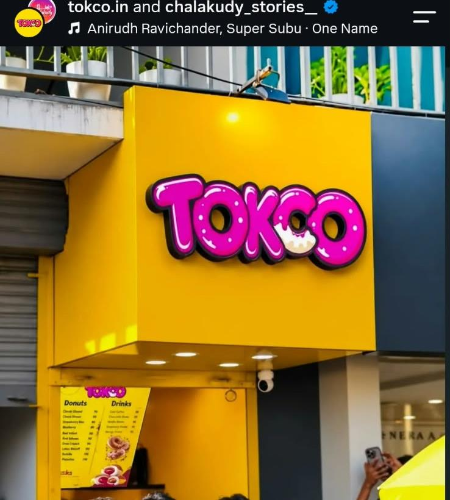

# TOKCO — Taste Your Happiness ✨ | Chalakudy, Kerala



> **Official website and interactive 3D dessert experience for TOKCO ([tokco.in](https://tokco.in/)), located on Tramway Lane, Chalakudy, Kerala.**  
> Crafted with React 19, Three.js, React Three Fiber, and Vite. Features a photorealistic chocolate-glazed donut with pastel sprinkles, authentic storefront photography, and continuous scroll storytelling.

---

## ✦ Brand Identity & Chalakudy Heritage

- **Brand:** TOKCO
- **Tagline:** *Taste Your Happiness ✨*
- **Flagship Location:** Tramway Lane, Chalakudy, Thrissur District, Kerala, India
- **Core Offerings:**
  - **Donuts:** Signature milk-chocolate glazed donuts with pastel sprinkles, fluffy yeast fried dough, and daily batch drops.
  - **Chocolate Breads:** Warm chocolate-filled buns with rich molten chocolate centers.
  - **Coffee & Drinks:** Handcrafted cold brews, creamy chocolate shakes, and bakery refreshments.
- **Instagram:** [@tokco.in](https://www.instagram.com/tokco.in/) (43K+ followers)
- **Primary Colors:** Sunshine Yellow (`#FFDD09`) & Glossy Magenta Pink (`#ED1B68`)
- **Supporting Palette:** Milk Chocolate (`#5A2E17`), Pastry Cream (`#FFF8E9`), Ink (`#261520`)

---

## ✦ Photorealistic 3D Chocolate Donut Engine

The central 3D attraction is an accurate, physically based recreation of TOKCO's real hand-dipped chocolate donut:

1. **Golden Fried Dough**:
   - Subdivided parametric torus ($R=1.45$, $r=0.68$) with organic proofing lumping.
   - Procedural baked crust texture with the distinctive pale blonde "fry line" proof band.
   - Micro-crumb bump mapping reflecting porous artisanal bread crust.
2. **Viscous Milk-Chocolate Glaze**:
   - Extruded geometric top layer with harmonic dripping lobes and thick rounded meniscus edges.
   - `MeshPhysicalMaterial`: Warm milk-chocolate diffuse (`#562A14`), clearcoat gloss (`1.0`), clearcoat roughness (`0.07`), and cocoa sheen (`0.4`).
3. **Chalakudy Pastel Sprinkles**:
   - 160 individually oriented capsule sprinkles adhering to surface normal vectors across the glaze crest.
   - Authentic pastel color palette matching the real TOKCO shop donut: Sky Blue (`#38BDF8`), Sunshine Yellow (`#FDE047`), Sugar White (`#FFFFFF`), Pastel Pink (`#F472B6`), and Mint Lime (`#A3E635`).
4. **Interactions**:
   - Touch & mouse drag-to-rotate with decaying inertia.
   - Subtle idle mouse hover parallax.
   - Coordinated camera and donut choreography across 5 narrative scroll scenes.

---

## ✦ 5-Scene Narrative Experience

- **Scene 1 — Welcome to TOKCO:** Sunshine-yellow hero with authentic TOKCO branding, "Taste Your Happiness ✨", Chalakudy location badge, and floating chocolate donut.
- **Scene 2 — Chocolate Experience:** Camera glides in close to inspect the rich milk-chocolate glaze, glossy specular highlights, and golden proof ring ("Made for your chocolate cravings").
- **Scene 3 — The TOKCO Menu:** Interactive 3-category showcase with real photography:
  - *Donuts* (Signature Chocolate Glazed)
  - *Chocolate Breads* (Warm Molten Chocolate Buns)
  - *Coffee & Drinks* (Cold Coffee & Shakes)
- **Scene 4 — The Real TOKCO:** Authentic photo gallery featuring the sunshine-yellow cube storefront, illuminated neon 3D sign at night, the counter team, and the viral Chalakudy community.
- **Scene 5 — Find Your Happiness:** Visit invitation to Tramway Lane, functional Google Maps directions button, Instagram follow card, and celebration confetti.

---

## ✦ Local SEO & Structured Data

Targeted for high-intent local dessert discovery:
- *TOKCO Chalakudy*
- *TOKCO donuts*
- *Chocolate donuts Chalakudy*
- *Chocolate breads Chalakudy*
- *Donuts in Chalakudy*
- *Tramway Lane Chalakudy*

Includes Schema.org `BakeryOrCafe` JSON-LD structured data with street address, coordinates query, cuisine categories, and social links.

---

## ✦ Development & Deployment

### Run Locally

```bash
git clone https://github.com/chatexploit/tokco-website.git
cd tokco-website
npm install
npm run dev
```

### Production Build

```bash
npm run build
npm run preview
```

### Custom Domain DNS Instructions for `tokco.in`

To map **tokco.in** to GitHub Pages:

| Type | Host / Name | Target / Value | TTL |
| :--- | :--- | :--- | :--- |
| **A** | `@` | `185.199.108.153` | 3600 |
| **A** | `@` | `185.199.109.153` | 3600 |
| **A** | `@` | `185.199.110.153` | 3600 |
| **A** | `@` | `185.199.111.153` | 3600 |
| **CNAME** | `www` | `chatexploit.github.io` | 3600 |

Once DNS records are propagated:
1. Open **[GitHub Settings > Pages](https://github.com/chatexploit/tokco-website/settings/pages)**.
2. Enter `tokco.in` under **Custom domain** and save.
3. Check **Enforce HTTPS** once the SSL certificate is issued.

---

## ✦ License

© 2026 TOKCO. All rights reserved. Original logo and real store photography belong to TOKCO, Tramway Lane, Chalakudy, Kerala.
